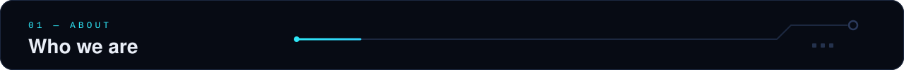
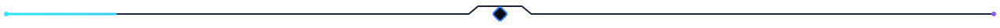
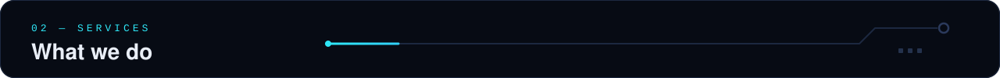
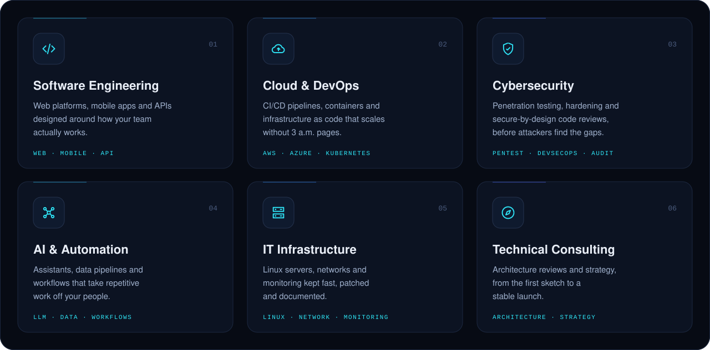
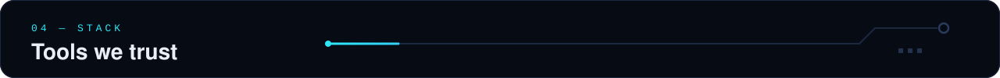
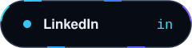

 

 

**Golden Vision** is an IT company that builds, runs and secures the technology businesses depend on.

We write the software, set up the cloud it lives in, and then test it the way an attacker would. What you get at the end is a system that is fast, stable and hard to break, plus a team that actually picks up the phone when something needs to change.

Our logo is a processor with an eye on its face. That is the whole idea in one picture: engineering that pays attention.

 

 

 

 

 

 

 

&nbsp;&nbsp;
&nbsp;&nbsp;

